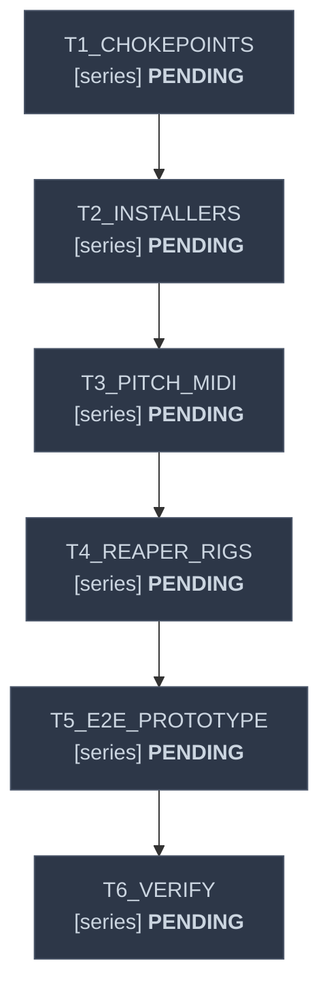

# Implementation Plan: REAPER Multi-Rig Real-Time Auto-Tune, A/B Benchmark & Seed-VC

- **Status:** approved
- **Spec:** [2026-11-09-reaper-autotune-spec.md](2026-11-09-reaper-autotune-spec.md)
- **Topology:** `single-agent` | **Integrity Mode:** `development`

## Task Graph Table

| ID | Task Name | Mode | Depends On | Inputs | Outputs | Gate | Status |
|---|---|---|---|---|---|---|---|
| T1_CHOKEPOINTS | Hostenv VST3, REAPER Audio Config & Seed-VC Chokepoints | series | none | docs/design/2026-11-09-reaper-autotune-spec.md, scripts/hostenv.py | scripts/hostenv.py, tests/test_pure.py | python3 -m unittest discover -s tests | PASSED |
| T2_INSTALLERS | Graillon 3 VST3, Demucs & Seed-VC Installers + Provisioning | series | T1_CHOKEPOINTS | scripts/hostenv.py, packages/manifest.json | scripts/install/graillon.sh, scripts/install/seed-vc.sh, packages/manifest.json | bash scripts/install/graillon.sh && bash scripts/install/seed-vc.sh && .venv/bin/python -c "import demucs, torchaudio" | PASSED |
| T3_PITCH_MIDI | Key/Scale Detection, Melody MIDI Extraction & Cent-Error Engine | series | T2_INSTALLERS | scripts/hostenv.py, skills/sound/scripts/soundlib.py | skills/sound/scripts/autotune.py, tests/test_pure.py | python3 skills/sound/scripts/autotune.py --help && python3 -m unittest discover -s tests | PASSED |
| T4_REAPER_RIGS | 10-Track Multi-Rig RPP, Live ReaScript, Karaoke Hook & Seed-VC CLI | series | T3_PITCH_MIDI | skills/sound/scripts/autotune.py, skills/sound/scripts/session.py, skills/sound/scripts/karaoke.py | skills/sound/scripts/autotune.py, skills/sound/scripts/session.py, skills/sound/scripts/karaoke.py, skills/sound/SKILL.md | python3 scripts/validate_skills.py && python3 -m unittest discover -s tests | PASSED |
| T5_E2E_PROTOTYPE | Ready-to-Sing REAPER Project, Synthetic Detuned Vocal Benchmark & Atelier Report | series | T4_REAPER_RIGS | skills/sound/scripts/autotune.py, scripts/install/graillon.sh, scripts/install/seed-vc.sh | out/autotune-studio/autotune-studio.rpp, out/autotune-studio/autotune-studio.fx-report.txt, out/autotune-studio/autotune-studio.benchmark.json, docs/report/2026-11-09-reaper-autotune-studio.html | python3 skills/sound/scripts/autotune.py --check-setup && test -s out/autotune-studio/autotune-studio.fx-report.txt && test -s out/autotune-studio/autotune-studio.benchmark.json | RUNNING |
| T6_VERIFY | Full Repo Regression & Quality Gate Certification | series | T5_E2E_PROTOTYPE | out/autotune-studio/autotune-studio.benchmark.json, docs/report/2026-11-09-reaper-autotune-studio.html | docs/design/2026-11-09-reaper-autotune-plan.md | python3 scripts/validate_skills.py && python3 -m unittest discover -s tests && python3 scripts/doctor.py --quick | PENDING |

## Live Mermaid Diagram

## Milestone Execution Notes

1. **`T1_CHOKEPOINTS` (`scripts/hostenv.py` + `tests/test_pure.py`):**
   - Add pure, testable helpers for `vst3_dirs()`, `find_vst3()`, `reaper_fx_ident()`, `parse_reaper_ini_audio()`, `reaper_audio_settings()`, and `seed_vc_paths()` with zero platform checks leaking into skill scripts.
2. **`T2_INSTALLERS` (`install/graillon.sh`, `install/seed-vc.sh`, `.venv`):**
   - Install `Auburn Sounds Graillon 3.vst3` into `~/Library/Audio/Plug-Ins/VST3` (macOS) / `~/.vst3` (Linux).
   - Install `demucs` + `torchaudio` into `.venv` via `uv pip install`.
   - Provision `~/.local/share/creative-stack/seed-vc` with `uv` Python `3.10` + pinned `Plachtaa/seed-vc` checkout + Apple Silicon `MPS` dependencies.
   - Update `packages/manifest.json` and regenerate `Brewfile` (`python3 scripts/packages.py --emit brewfile`) if manifest changes.
3. **`T3_PITCH_MIDI` (`skills/sound/scripts/autotune.py`):**
   - Implement Krumhansl-Schmuckler chroma key/scale estimation, `librosa.pyin` monophonic melody MIDI extraction (`<stem>.melody.mid`), chroma cross-correlation alignment for `--reference-song`, and cent-error benchmark math (`median_abs_cents`, `pct_within_25_cents`, `pct_within_50_cents`), covered by pure unit tests in `tests/test_pure.py`.
4. **`T4_REAPER_RIGS` (`autotune.py`, `session.py`, `karaoke.py`, `skills/sound/SKILL.md`):**
   - Emit the 10-track Multi-Rig `.rpp` + `.autotune.lua` ReaScript (verified live via `REAPER -nonewinst` -> `<stem>.fx-report.txt`), `--benchmark` stem renderer, and `--ai-voice` / `--launch-live-vc` `Seed-VC` runners.
5. **`T5_E2E_PROTOTYPE` (`out/autotune-studio/` + `docs/report/`):**
   - Build a live, ready-to-sing REAPER Auto-Tune Studio session (`out/autotune-studio/autotune-studio.rpp`), synthesize a deliberately badly-pitched test vocal (`50–200 cents` sharp/flat + wrong-note drift) to prove and visualize **Rig 0 (Without Auto-Tune) vs. Rig 1A (`ReaTune`) vs. Rig 1B (`ReaVocode`) vs. Rig 2 (`Graillon 3` MIDI-Lock) vs. Rig 4 (`Seed-VC`)**, and publish a bespoke Atelier HTML engineering & benchmark readout.
6. **`T6_VERIFY`:**
   - Run `validate_skills.py`, `unittest`, `doctor.py --quick`, and standalone `--help` checks across all scripts.
